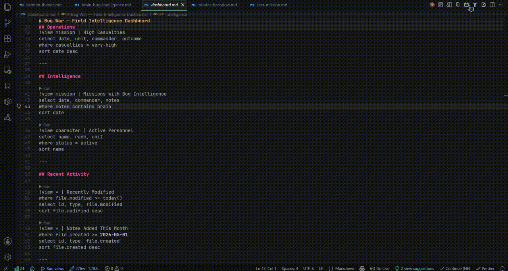
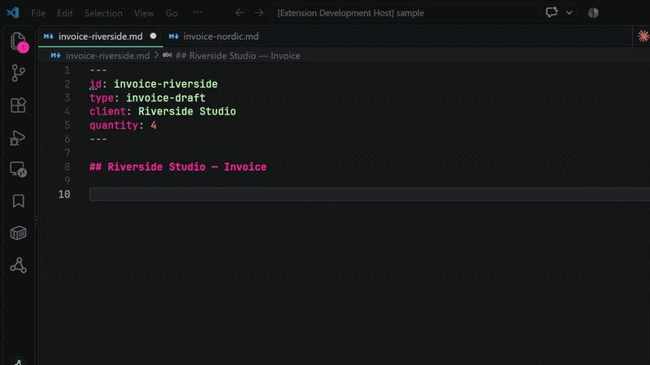
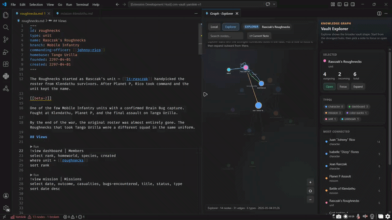
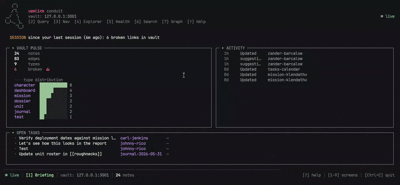
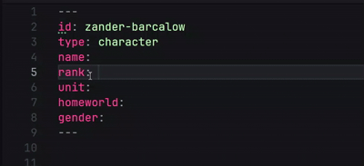
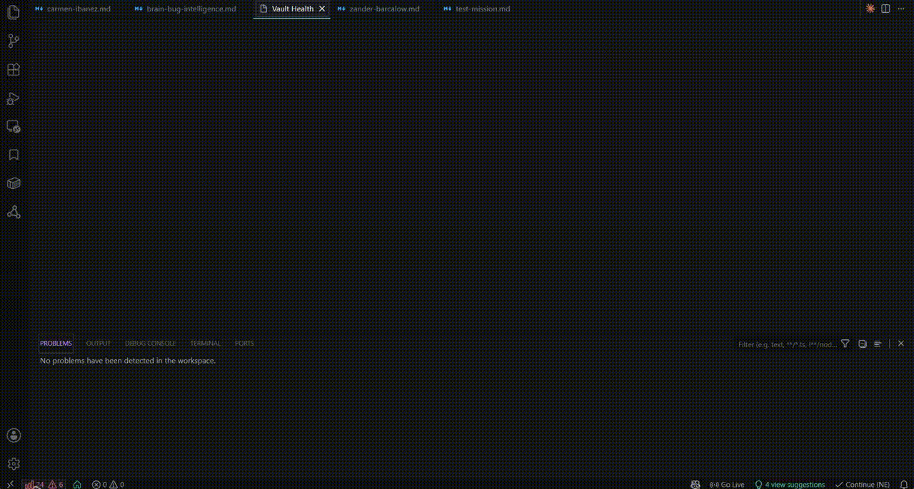

<div align="center">

#  Yamlink

### Your Markdown, connected and computable.
Live tables, formulas, relationships, and visualizations. All powered by the same local Markdown files. 
No database. No sync account. Your notes stay <code>.md</code> files you can open in any editor, forever.

[](https://github.com/Yamlink-Labs/yamlink/actions/workflows/ci.yml)
[](https://marketplace.visualstudio.com/items?itemName=yamlink.yamlink)
[](./LICENSE)

<p>
<a href="https://github.com/Yamlink-Labs/yamlink"></a>
<a href="https://www.yamlink.dev"></a>
<a href="https://x.com/yamlinklabs"></a>
</p>

**[Getting Started](./GETTING_STARTED.md)** &nbsp;·&nbsp; **[Sample vault](https://github.com/Yamlink-Labs/yamlink-sandbox)**

</div>

---

<div align="center">


</div>

<br>

<div align="center">

### **WHAT YAMLINK IS**

</div>

<table>
<tr>
<td width="50%" valign="top">

### Live tables from your data.

Turn your notes into searchable, sortable, editable tables with `!view`. Change a value in the table, and Yamlink updates the original MD file. No duplicated data. No separate database.



</td>
<td width="50%" valign="top">

### Formulas to connect your notes

Write formulas directly in Markdown. Reference values from frontmatter, other calculations, linked notes, or entire query results. From simple arithmetic to financial models, your notes can calculate with the information they already contain.



</td>
</tr>
<tr>
<td width="50%" valign="top">

### The graph: visualize your connections

Every `[[wikilink]]` becomes a relationship you can explore. Filter by type, navigate connected notes, and replay how your knowledge graph evolved over time. Your graph grows as you write.



</td>
<td width="50%" valign="top">

### Conduit — the whole vault, in a terminal

Run `yamlink` and run yout entire vault from the terminal. Browse, edit, query, inspect relationships, and explore your graph through a keyboard-driven interface. The same knowledge system, without needing VS Code.



</td>
</tr>
<tr>
<td width="50%" valign="top">

### Intelligence from your own data

Yamlink learns how you structure *your* notes and suggests fields, relationships, and templates based on patterns in your own vault. No cloud processing. No external AI models. Just intelligence derived from your data.



</td>
<td width="50%" valign="top">

### Know the state of your vault

Find broken links, missing fields, inconsistent structures, and orphaned notes before they become problems. Explore your vault's history and see projections of how its structure and activity may evolve.



</td>
</tr>
</table>

---

<details>
<summary><strong>Full feature list & guides</strong></summary>

Yamlink's local engine powers more than the VS Code extension. Explore your vault through the CLI, Conduit terminal workspace, or HTTP API — all working with the same Markdown files.

- **[FEATURES.md](./FEATURES.md)** — the complete feature list: graph, block references, query language, chart views, intelligence, Vault Health, and more.
- **[CALCULATIONS.md](./CALCULATIONS.md)** — the formula engine: same-note and cross-note references, ranges, finance/stats/growth functions, formatting.
- **[CLI.md](./CLI.md)** — the `yamlink` command: querying, editing, automating, and serving your vault from a terminal.
- **[CONDUIT.md](./CONDUIT.md)** — the full terminal workspace: ten screens, live updates, zero mouse required.
- **[API.md](./API.md)** — a quick start for scripting against your vault over a local HTTP server.

</details>

<details>
<summary><strong>What's new this release</strong></summary>

**0.8.4 — Security & Stability.** A deliberate change of pace: before anything else ships, this release is entirely about making sure what already exists holds up under real scrutiny. No new features.

- **A security hardening pass**, across multiple rounds of adversarial review — authentication required by default on the local API, SSRF protection on webhooks, path-traversal and symlink/hardlink protections across publishing, importing, and exporting, a new `yamlink mutations purge-field` command for redacting sensitive historical values, and more. See `CHANGELOG.md` for the full, itemized list.
- **If you already use `yamlink publish`: a note must now opt in before it's published.** Previously any note was published by default unless marked `status: draft`/`archived`. Now a note needs `publish: true` (or `status: published`) to be included — **your next build may contain fewer notes than before.** Add `publish: true` to any note you want to keep publishing.
- **Two real performance fixes** — Vault Health no longer re-reads every note's file timestamp from disk on every refresh, and `yamlink bulk-set` now writes its mutation history once per operation instead of once per note.

Full list: [CHANGELOG.md](./CHANGELOG.md).

</details>

---

## Getting Started

```bash
code --install-extension yamlink.yamlink
```

<div align="center">Open any folder of Markdown files. Add <code>id: something</code> to a note's frontmatter. You have a vault.</div>

---

<div align="center">

<small>If Yamlink is useful to you, a <a href="https://github.com/Yamlink-Labs/yamlink">star on GitHub</a> or a review on the <a href="https://marketplace.visualstudio.com/items?itemName=yamlink.yamlink">VS Code Marketplace</a> genuinely helps.</small>

<small>MIT License — see <a href="./LICENSE">LICENSE</a>.</small>

</div>
